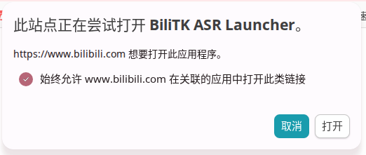

# BiliTk — Bilibili Toolkit

> 一款基于油猴脚本的 B 站助手：下载字幕、用 AI 把视频变成可读笔记、一键复制干净链接。

[](https://www.gnu.org/licenses/gpl-3.0.html)
[](https://www.tampermonkey.net/)

BiliTk 由 [SavingPot](https://space.bilibili.com/515982690) 开发，基于 GPL-3.0 协议开源。遇到问题欢迎提 Issue，或 Fork 后发起 Pull Request。

---

## 目录

- [功能特性](#功能特性)
- [快速开始](#快速开始)
  - [1. 安装用户脚本](#1-安装用户脚本)
  - [2. （可选）配置本地 ASR 语音识别](#2-可选配置本地-asr-语音识别)
  - [3. 使用](#3-使用)
- [设计理念](#设计理念)
- [工作原理与安全性](#工作原理与安全性)
- [常见问题 FAQ](#常见问题-faq)
- [贡献](#贡献)
- [License](#license)
- [致谢](#致谢)

---

## 功能特性

| 功能 | 说明 |
| --- | --- |
| **字幕下载** | 一键下载当前视频的 CC 字幕；无字幕时可退回本地 ASR 识别 |
| **AI 总结 / 辅助** | 支持 DeepSeek / 智谱清言，基于字幕生成可直接复制的完整笔记，可选择是否保留时间戳 |
| **精简链接复制** | 复制去除追踪参数的视频链接 |
| **Markdown 链接复制** | 复制为 `[标题](链接)` 格式，方便贴进笔记 |
| **本地 ASR 兜底** | UP 主关闭 CC 字幕时，可在本地把音频转成字幕 |

适用于绝大多数 B 站页面：普通视频页、收藏列表播放页、稍后再看页等。

---

## 快速开始

### 1. 安装用户脚本

目前仅支持手动安装。

1. 安装用户脚本管理器，例如 [Tampermonkey](https://www.tampermonkey.net/) 或 [Violentmonkey](https://violentmonkey.github.io/)。
2. 浏览器默认可能限制用户脚本运行。请在扩展管理页打开 Tampermonkey 的设置，允许运行用户脚本。
3. 在管理器中点击“新建脚本”。
4. **删除编辑器中的全部默认内容**（包括注释）。
5. 打开 [BiliTk.user.js](https://github.com/SavingPot/BiliTk/blob/main/BiliTk.user.js)，**复制全部文本**（同样包括注释），粘贴进编辑器。
6. 保存并启用脚本。

> 第 4、5 步的“全部内容”很容易漏掉注释，请务必确认复制完整后再保存。

---

### 2. （可选）配置本地 ASR 语音识别

只有需要处理“UP 主关闭了 CC 字幕”的视频时才需要这一步。用户脚本权限有限，无法直接在浏览器里跑语音模型，因此需要连接外部程序 [bili-tk-asr](https://github.com/SavingPot/bili-tk-asr)，并配置 Python 环境。

#### ① 安装 uv

`uv` 是用 Rust 重写的高效 Python 包管理器。先检查本机是否已安装：

```bash
uv --version
```

如果没有，执行官方安装脚本（网络较慢时建议挂代理或使用镜像源）：

**Linux**

```bash
wget -qO- https://astral.sh/uv/install.sh | sh

# 或
curl -LsSf https://astral.sh/uv/install.sh | sh

# 或使用镜像源
curl -LsSf https://gitee.com/wangnov/uv-custom/releases/download/0.9.22/uv-installer-custom.sh | sh
```

**Windows**

暂未提供安装说明，欢迎贡献 PR。

#### ② 安装 bili-tk-asr

**方式 A：使用 Release 中的安装脚本**

下载 [bili-tk-asr](https://github.com/SavingPot/bili-tk-asr) 的 Release，解压到任意目录，然后在该目录执行：

```bash
chmod +x install.sh
./install.sh
```

**方式 B：手动安装**

```bash
# 1. 克隆仓库
git clone https://github.com/SavingPot/bili-tk-asr.git
cd bili-tk-asr

# 2. 创建干净的 Python 3.12 虚拟环境
uv venv --python 3.12
source .venv/bin/activate

# 3. 安装依赖
uv pip install fastapi uvicorn python-multipart funasr_onnx modelscope

# 若 funasr_onnx 报 BaseException，强制安装修复版：
# uv pip install --force-reinstall --no-deps "git+https://github.com/modelscope/FunASR.git#subdirectory=runtime/python/onnxruntime"

# 4. 下载 SenseVoiceSmall ONNX 模型（需要访问 Hugging Face）
mkdir -p SenseVoiceSmall-onnx
cd SenseVoiceSmall-onnx

wget -O model_quant.onnx \
  https://huggingface.co/DennisHuang648/SenseVoiceSmall-onnx/resolve/main/model_quant.onnx
wget -O chn_jpn_yue_eng_ko_spectok.bpe.model \
  https://huggingface.co/FunAudioLLM/SenseVoiceSmall/resolve/main/chn_jpn_yue_eng_ko_spectok.bpe.model
wget -O config.yaml \
  https://huggingface.co/DennisHuang648/SenseVoiceSmall-onnx/resolve/main/config.yaml
wget -O tokens.json \
  https://huggingface.co/DennisHuang648/SenseVoiceSmall-onnx/resolve/main/tokens.json
wget https://hf-mirror.com/FunAudioLLM/SenseVoiceSmall/resolve/main/am.mvn

# 伪装成 FP32 原始模型
mv model_quant.onnx model.onnx

cd ..
```

> **内存不足提示**：如果 ASR 运行到一半服务突然退出，通常是内存不足被系统杀掉。可增加音频切分次数以降低峰值负载。可用视频 [云飞聊Linux 字体比windows好](https://www.bilibili.com/video/BV1hZdLYyEEA) 测试 ASR 功能。

首次运行时，浏览器会请求连接本地 ASR 服务，建议勾选“始终允许”：



#### ③ 查看或关闭 ASR 服务

自动启动的 `server.py` 是静默运行的。常用命令：

```bash
# 查看是否在运行
ps aux | grep server.py

# 查看实时日志（推荐）
./launch_asr.sh

# 关闭服务
pkill -f "bili-tk-asr/server.py"

# 手动、非静默地启动服务（先确保没有正在运行的 server.py）
cd bili-tk-asr
uv run server.py
```

---

### 3. 使用

打开任意 B 站视频页，使用右上角的 BiliTk 按钮即可。字幕下载、AI 总结、链接复制等操作均为单击完成。

---

## 设计理念

BiliTk 和常见的 B 站助手有几个不同点：

1. **面向笔记，而不是视频目录。** 总结完全基于字幕，并会自动修正字幕，输出可直接复制的完整笔记，不会插入突兀的字幕截图或图片。
2. **极致快捷。** 按钮默认展开、不折叠、不隐藏；绝大多数操作点一下就能完成。
3. **把“本可以写成文章的视频”变成文章。** 很多视频的信息密度更适合阅读。用 BiliTk 先读文章版，可以快速判断视频是否值得完整观看；深度内容仍建议看原片。
4. **对抗“看完即忘”。** 视频是线性播放的，看完容易只留下模糊印象；转成文字纲要后，信息以可控的方式呈现，更容易抓住核心。
5. **减少工作流摩擦。** 过去需要“复制字幕 → 打开 AI 网页 → 粘贴”，现在只需点击一次按钮。

---

## 工作原理与安全性

- 字幕下载内置限流与随机抖动，避免请求过于频繁。
- “发送到 AI”是把预设 Skill 与字幕内容一起发送到 DeepSeek / 智谱清言网页端，通过模拟用户点击、粘贴、回车完成，不调用非公开接口，风险相对较低。
- 脚本本身不收集、不上传用户数据；ASR 服务运行在本地。
- 脚本开源，欢迎自行审查代码。

---

## 常见问题 FAQ

**Q：脚本按钮没有出现？**
A：确认脚本已在 Tampermonkey / Violentmonkey 中启用，并检查浏览器是否允许该扩展运行用户脚本。刷新视频页后重试。

**Q：AI 总结失败怎么办？**
A：目前 AI 总结支持 DeepSeek 和智谱清言。请确认已登录对应网页端，并检查网络是否可正常访问。模拟操作依赖页面结构，若网页改版可能导致暂时失效，请提 Issue。

**Q：ASR 服务运行中突然退出？**
A：大概率是内存不足被系统终止。可增加音频切分次数，或换用内存更大的机器。

**Q：如何关闭自动启动的 ASR 服务？**
A：执行 `pkill -f "bili-tk-asr/server.py"`。

**Q：支持其他 AI 吗？**
A：目前支持 DeepSeek 和智谱清言。有条件的用户建议使用 BYOK（Bring Your Own Key）方式，以支持国内 AI 生态发展。

**Q：使用脚本会导致数据丢失吗？**
A：脚本原理上不会造成数据丢失，但使用产生的相关后果由用户自行承担。

---

## 贡献

- 发现问题：欢迎提交 [Issue](https://github.com/SavingPot/BiliTk/issues)。
- 改进代码：Fork 仓库后发起 Pull Request。
- 完善文档：尤其是 Windows 下的 ASR 安装步骤，欢迎补充。

---

## License

本项目基于 [GPL-3.0](https://www.gnu.org/licenses/gpl-3.0.html) 协议开源。

> 本工具仅供个人学习使用，不得商用。

---

## 致谢

- 灵感来自 [BiliClipper](https://github.com/echore/bili-clipper)
- 字幕下载部分参考 [Bilibili CC Subtitle Tool](https://github.com/WanderLandWalker/Bilibili-CC-Subtitle-Tool)
- WBI 签名代码来自 [kaixinol](https://update.greasyfork.org/scripts/580254/1837601/Bilibili%20WBI%20Signer%20Library.js)

如果 BiliTk 帮到了你，欢迎给项目点一个免费的 Star ⭐
