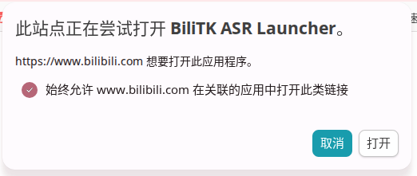

# BiliTk——Bilibili Toolkit 是什么
这是一个基于油猴脚本的B站助手，主要功能是：
- 字幕下载（无字幕时，可退回到本地字幕识别（ASR））
- 基于字幕的视频 AI 总结（可以选择是否带有对应时间）
- 视频精简链接复制
- 视频链接的 Markdown 格式复制

<br>

该脚本由 [SavingPot](https://space.bilibili.com/515982690) 开发，是一款基于 GPL3.0 协议的自由软件，如果程序有问题，欢迎提出 Issue，或是 Fork 后发起 Pull Request 合并仓库。 <br>


<br>
<br>

# 一. 特别之处（以及为什么要自己开发一个脚本）
1. 该脚本的总结功能与常见的 B 站助手的区别是，它适合用来直接生成可复制的完整笔记，而不是没用的视频目录。它完全基于字幕来总结，并且会自动修正字幕，生成的内容可以直接作为笔记复制，没有常规助手那样的突兀字幕与图片。
2. 本脚本的宗旨是极致快捷，所以按钮默认不折叠、不隐藏，而是完整显示，而且绝大多数的按钮只要轻点一下即可完成所有操作。
3. 如今有用的文章越来越少，而依赖视频和AI的人越来越多。许多视频本可以作为一个文章发布，但却为了迎合用户需求做成了视频，而这个脚本就可以帮助你把视频变成文章或笔记，让你快速看完改视频。当然，一个深度的视频并不输给文字，所以如果视频的内容很好，那么也建议你看完原视频。

<br>
<br>

# 二. 安装方法
## 1. 插件本体的安装
### 方法一. 手动安装（目前只支持手动安装）
#### 安装脚本
1. 安装用户脚本管理器（此处以 Tampermonkey 为例），例如 [Tampermonkey](https://www.tampermonkey.net/) 和 [Violentmonkey](https://violentmonkey.github.io/)。
2. 浏览器可能会默认限制 Tampermonkey 的功能，所以要先在拓展管理中，打开 Tampermonkey 的设置界面，点击允许运行用户脚本。
3. 打开管理器，选择“新建脚本”。
4. 删除编辑器中的默认内容（务必注意，是所有内容！包括注释！）
5. 将 [BiliTk.user.js](https://github.com/SavingPot/BiliTk/blob/main/BiliTk.user.js) 里的文本全部复制进去。（务必注意，是全部文本，全部文本，全部文本！！！包括注释，包括注释，包括注释！！！！！！！！）
5. 保存脚本并启用。（务必不要忘记这一步！！）


## 2. （可选）ASR 功能（语音模型）的安装

有些视频 UP 主关闭了 CC 字幕，所以没法直接总结，那么就需要在本地进行语音转字幕。由于用户脚本的权限有限，所以需要连接外部程序，这里我使用的是 [Bili2Text](https://github.com/SavingPot/bili-tk-asr)，因此需要配置 Python 环境

### ①配置 UV

首先需要检查是否有 uv（Python 的一种 Rust 重写的高效包管理器）。如果没有的话，运行以下指令来运行官方的安装脚本（注意：这一步可能很慢，所以尽量挂梯子，或使用镜像源）：

#### Linux 用户
```bash
wget -qO- https://astral.sh/uv/install.sh | sh

#或 curl -LsSf https://astral.sh/uv/install.sh | sh
#或镜像源 curl -LsSf https://gitee.com/wangnov/uv-custom/releases/download/0.9.22/uv-installer-custom.sh | sh
```

#### Windows 用户

还没写


### ②配置 bili-tk-asr


先找到一个地方用来放置 asr 脚本，在那里打开终端
```bash
# 1. 克隆库
git clone https://github.com/SavingPot/bili-tk-asr.git

# 2. 进入目录
cd bili-tk-asr

# 3. 创建干净的 Python 3.12 虚拟环境
uv venv --python 3.12
source .venv/bin/activate

# 4. 安装库
uv pip install fastapi uvicorn python-multipart funasr_onnx modelscope

# 💡 如果 funasr_onnx 报 BaseException 错误，直接强制覆盖为修复版：
# uv pip install --force-reinstall --no-deps "git+https://github.com/modelscope/FunASR.git#subdirectory=runtime/python/onnxruntime"

# 5. 安装 asr 模型（这一步需要梯子）
mkdir -p SenseVoiceSmall-onnx
cd SenseVoiceSmall-onnx
wget -O model_quant.onnx \
  https://huggingface.co/DennisHuang648/SenseVoiceSmall-onnx/resolve/main/model_quant.onnx
wget -O chn_jpn_yue_eng_ko_spectok.bpe.model \
  https://huggingface.co/FunAudioLLM/SenseVoiceSmall/resolve/main/chn_jpn_yue_eng_ko_spectok.bpe.model
wget -O config.yaml \
  https://huggingface.co/DennisHuang648/SenseVoiceSmall-onnx/resolve/main/config.yaml
wget -O tokens.json \
  https://huggingface.co/DennisHuang648/SenseVoiceSmall-onnx/resolve/main/tokens.json
wget https://hf-mirror.com/FunAudioLLM/SenseVoiceSmall/resolve/main/am.mvn -P SenseVoiceSmall-onnx/
mv model_quant.onnx model.onnx #伪装成全精度（FP32）的原始模型
```


注意：如果在运行 ASR 的过程中，服务器突然自己关掉了，那么大概率是内存不足，导致进程被系统杀了，例如
```bash
开始识别音频: /tmp/tmp3u3_p9tk.m4s.wav
savingpot@savingpot-Katana-GF66-11UC:~/Tools/bili-tk-asr$ 
```
这种情况通常发生在内存较小的机器上。如果遇到这种情况，就只能强制增加切分次数来确保负载平稳，

可以用[云飞聊Linux 字体比windows好](https://www.bilibili.com/video/BV1hZdLYyEEA)来测试 ASR 功能。




### ③🔍 如果想看 bili-tk-asr 在干什么，或者想关掉它，怎么办？
自动启动的 server.py 是静默的。如果你希望调试它，可以这几个常用命令：

**1. 看它在不在跑（状态）**
```bash
ps aux | grep server.py
```
如果有输出，说明正在后台运行。

**2. 看它的实时日志（比如有没有报错）**
```bash
tail -f /mnt/superfast/Projects/Tools/Python/bili-tk-asr/asr.log
```

**3. 怎么关掉它？**
```bash
pkill -f "bili-tk-asr/server.py"
```

**4. 可以不静默打开，而是手动、非静默地启动服务器**
先确保没有正在运行的 server.py，然后先定位到 bili-tk-asr 文件夹，然后运行
```bash
uv run server.py
```


<br>
<br>

# 三. 使用方法

打开任意一个 B 站视频，就可以使用右上角的按钮了！

<br>
<br>

# 四. 工作原理
1. 脚本下载字幕的过程中内置限流、抖动等安全功能。<br>
2. 发送到 DeepSeek 功能是把 Skill 和字幕内容一起发送给 DeepSeek 网页端，原理是模拟用户的点击、粘贴、回车等等，因此风险相对较低。
3. 适用于绝大多数的 B 站页面，无论是普通页面，收藏列表播放页面还是稍后再看页面都可以。

<br>
<br>

# 五. 注意
1. 本工具仅供个人学习使用，不得商用。
2. 有条件的用户请使用 BYOK 以支持国内的 AI 发展。
3. 目前 AI 总结仅支持 DeepSeek。
4. 本脚本原理上不会造成数据丢失等后果，但如果有各种相关后果，用户自行承担。
5. 本脚本安全无毒，也欢迎使用 AI 审查。

<br>
<br>

# 六. 特别鸣谢
- 来自 [BiliClipper](https://github.com/echore/bili-clipper) 的灵感启发
- 来自 [Bilibili CC Subtitle Tool](https://github.com/WanderLandWalker/Bilibili-CC-Subtitle-Tool) 的字幕下载部分脚本
- 来自 [kaixinol](https://update.greasyfork.org/scripts/580254/1837601/Bilibili%20WBI%20Signer%20Library.js) 的 WBI 签名代码


如果该脚本帮助到了你，请务必给一个免费的 Star！

